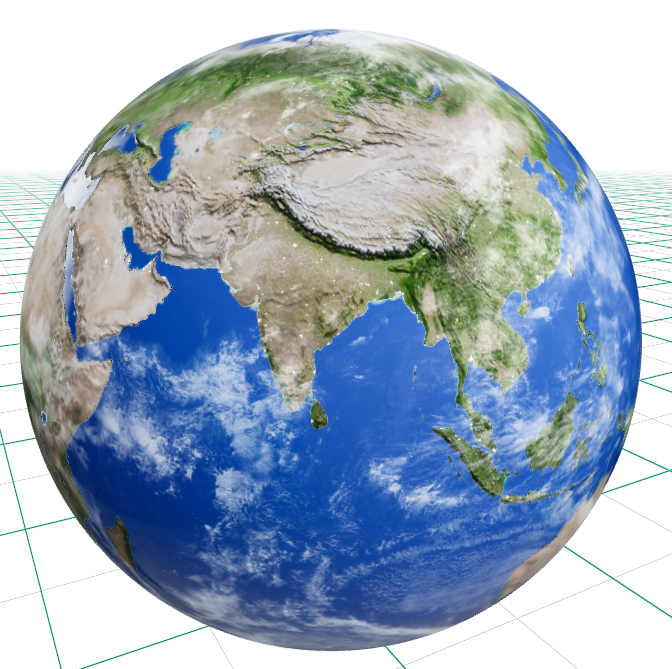
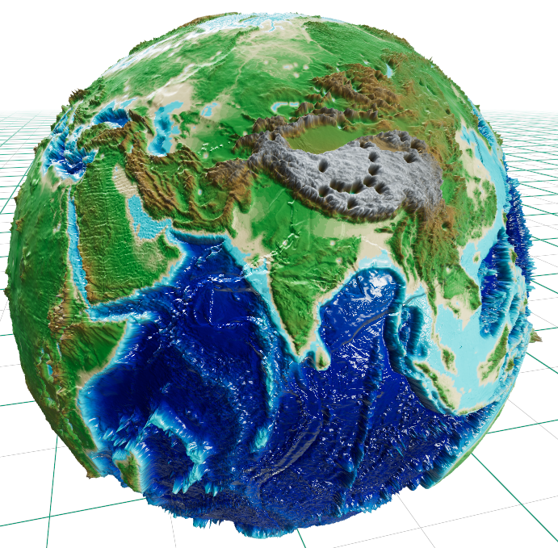
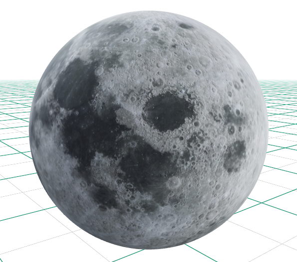

# 3D Celestial Models Generator & Optimizer

<p align="center">
  
  
  
  
  
</p>

A high-fidelity procedural 3D model generator for astronomical bodies (Earth, Moon, and Topographic Relief Earth) paired with an automated GLB/GLTF compression and optimization pipeline.

---

## Model Showcase

<table>
  <tr>
    <td align="center" width="33%">
      <a href="screenshots/earth.png">
        
      </a>
      <br />
      <b>Layered Earth</b>
      <br />
      <sub>Atmosphere, day/night lights, clouds</sub>
    </td>
    <td align="center" width="33%">
      <a href="screenshots/earth_terrain.png">
        
      </a>
      <br />
      <b>Topographic Relief Earth</b>
      <br />
      <sub>Exaggerated elevation & bathymetry</sub>
    </td>
    <td align="center" width="33%">
      <a href="screenshots/moon.png">
        
      </a>
      <br />
      <b>8K Moon</b>
      <br />
      <sub>Bump-mapped lunar surface</sub>
    </td>
  </tr>
</table>

---

## Features

### 1. Photorealistic Layered Earth (`create_earth.py`)
- **Multi-Layered Architecture**: Independent concentric geometry shells for the terrestrial surface, cloud cover, and atmospheric glow.
- **Dynamic Surface Textures**: 8K daytime surface map, specular water reflection mask, and city night lights.
- **Cloud Layer**: Alpha-masked cloud shell with realistic orbital altitude and transparency.
- **Geological Cross-Section**: Internal crust, mantle, and core layers.

### 2. Exaggerated Topographic Relief Earth (`create_topographic_earth.py`)
- **NASA Elevation & Bathymetry**: Real-world elevation displacement driven by NASA GEBCO topographical datasets.
- **Relief Exaggeration**: Exaggerated mountain ranges and deep ocean trenches to produce tangible tactile globe models.
- **PBR Shading**: Procedural normal and roughness maps for realistic land vs. ocean light scattering.

### 3. 8K High-Resolution Moon (`create_moon.py`)
- **8K Lunar Mapping**: Ultra-high-resolution imagery capturing craters, rilles, and lunar maria.
- **Procedural Normal Map**: Directional Sobel-filtered normal maps generated directly from lunar elevation maps.
- **Oblateness & Terminator Smoothness**: Mathematically calibrated lunar flattening with 1024-segment resolution to eliminate jagged terminator shadows.

### 4. Interactive Generator & Batch Runner (`build_model.bat` / `run_generator.py`)
- **Flexible Generation**: Build models individually (1 by 1) or generate all models simultaneously in a single automated batch.
- **Continuation Loop**: Seamless interactive prompt asking whether to build more models or exit upon completion.
- **Duplicate Protection**: Automatically detects existing files and adds sequential versioning (e.g., `earth_1.glb`) to avoid overwriting.

### 5. Automated Model Compressor (`compressor/`)
- **CLI & Drag-and-Drop Pipeline**: Powered by `@gltf-transform/cli`.
- **Optimization Stack**: Converts textures to WebP, applies Meshopt geometry compression, and deduplicates vertex buffers, achieving **60%–80% smaller file sizes** with negligible visual degradation.

---

## Directory Structure

```text
3D-Models/
├── build_model.bat            # 1-Click interactive launcher for model creation
├── compressor/
│   ├── compress_model.bat     # Interactive batch compressor
│   └── compress_model.py      # GLTF/GLB optimization engine
├── output/                    # Generated 3D models saved here (.glb)
├── screenshots/               # Model renders and showcase previews
│   ├── earth.png              # Layered Earth render
│   ├── earth_terrain.png      # Topographic Earth render
│   └── moon.png               # 8K Moon render
└── scripts/
    ├── run_generator.py       # Script runner and batch manager
    ├── create_earth.py        # Layered Earth generation script
    ├── create_moon.py         # 8K Moon generation script
    ├── create_topographic_earth.py # Topographic relief Earth script
    └── textures/              # Texture assets cache
```

---

## Getting Started

### Prerequisites

1. **Python 3.10+** with required libraries:
   ```bash
   pip install trimesh pillow numpy pygltflib requests scipy
   ```

2. **Node.js / npx** (required only for the model compressor):
   ```bash
   # Verify Node.js / npx installation
   npx --version
   ```

---

## Usage

### 1. Generating Models

#### Method A: Double-Click Launcher (Windows)
Double-click `build_model.bat` in the project root to open the interactive console menu:
```text
===================================================
             3D Model Script Generator             
===================================================

Available 3D Model Options:
  [1] create_earth.py
  [2] create_moon.py
  [3] create_topographic_earth.py
  [4] Generate ALL models at once (or 'A')
  [Q] Exit

Enter option (1-4, A for all, Q to exit):
```
After generation finishes, you can choose to build another model or exit cleanly.

#### Method B: Command Line (CLI)
Run the script runner directly via Python:
```bash
# Interactive menu
python scripts/run_generator.py

# Generate ALL models at once
python scripts/run_generator.py all

# Generate an individual model
python scripts/run_generator.py earth
python scripts/run_generator.py moon
python scripts/run_generator.py topographic
```

All generated `.glb` models are automatically stored in the `output/` directory.

---

### 2. Compressing 3D Models

To compress and optimize generated models for web viewers, mobile applications, or real-time 3D engines:

1. Double-click `compressor/compress_model.bat`, or run:
   ```bash
   python compressor/compress_model.py
   ```
2. Select your model from the numbered list or drag and drop a `.glb` / `.gltf` file directly onto `compress_model.bat`.
3. The optimized file will be saved as `<model_name>_compressed.glb` in `output/`.

---

## License

This project is licensed under the MIT License. See [LICENSE](LICENSE) for details.
